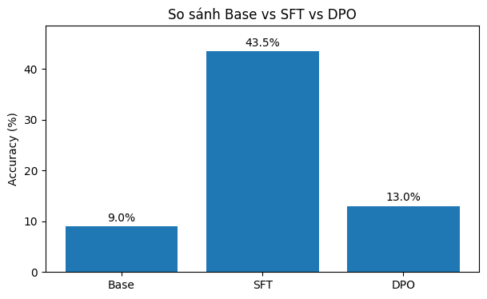
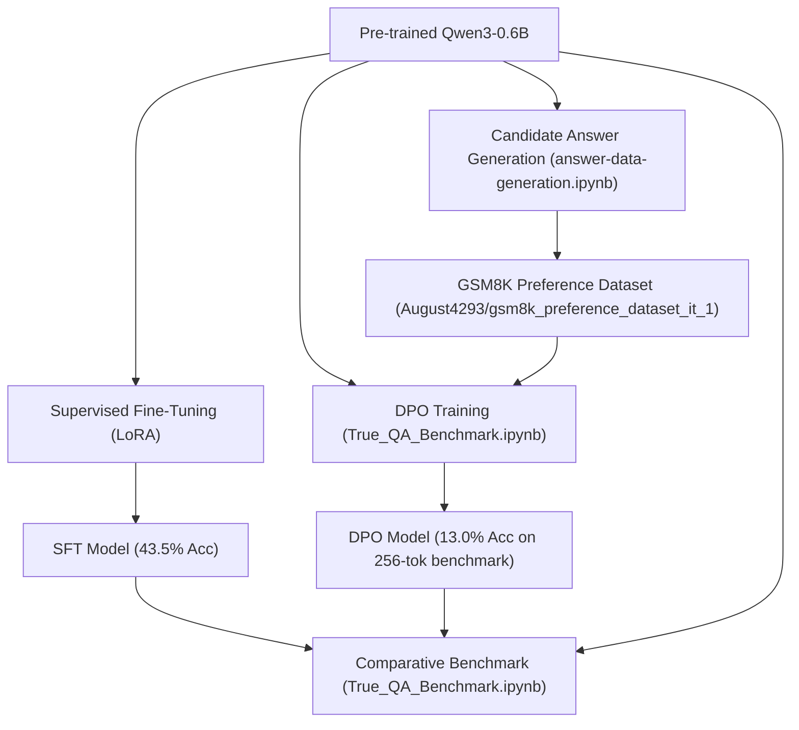

# Math Reasoning Fine-Tuning on GSM8K

This repository explores fine-tuning and alignment techniques to enhance the mathematical reasoning capabilities of the lightweight **Qwen3-0.6B** (`Qwen/Qwen3-0.6B`) model on the **GSM8K** (Grade School Math 8K) dataset.

We investigate and compare three model iterations:
1. **Base**: Pre-trained `Qwen/Qwen3-0.6B` (zero-shot).
2. **SFT**: Supervised Fine-Tuning using Low-Rank Adaptation (LoRA) on GSM8K step-by-step reasoning solutions.
3. **DPO**: Direct Preference Optimization on top of the base/reference model using generated preference pairs (`August4293/gsm8k_preference_dataset_it_1`).

---

## 📊 Benchmark Results

Evaluations were conducted on a randomly selected sample of **200 test questions** from the `gsm8k` (`main`, split `test`) dataset, using exact numerical matching against ground truth answers (`#### <number>`).

### GSM8K Test Split Accuracy (N = 200)

| Model Variant | Base Architecture | Tuning Technique | Accuracy (%) | Relative Improvement |
| :--- | :--- | :--- | :---: | :---: |
| **Base** | `Qwen/Qwen3-0.6B` | None (Pre-trained) | **9.0%** | Baseline |
| **SFT** | `Qwen/Qwen3-0.6B` | LoRA SFT | **43.5%** | **+34.5%** (+383% relative) |
| **DPO** | `Qwen/Qwen3-0.6B` | LoRA DPO ($\beta=0.1$) | **13.0%** | **+4.0%** (+44% relative) |



```text
Accuracy Comparison (GSM8K Test Set, 200 samples)
--------------------------------------------------
Base : [███                              ]  9.0%
SFT  : [██████████████                   ] 43.5%
DPO  : [████                             ] 13.0%
--------------------------------------------------
```

---

### Preference Dataset Evaluation (Test Split, N = 10)

Evaluated against reference solutions on the preference test split (`August4293/gsm8k_preference_dataset_it_1`):

| Model | Token-Level F1 Score | Numeric Correctness |
| :--- | :---: | :---: |
| **SFT** | **0.3549** (35.5%) | **0.4000** (40.0%) |
| **DPO** | **0.2801** (28.0%) | **0.2000** (20.0%) |

---

## 🔍 Key Insights & Analysis

1. **Substantial Gains from SFT**:
   - Applying LoRA SFT on GSM8K increases accuracy from **9.0% to 43.5%**.
   - The base 0.6B model inherently possesses basic arithmetic knowledge but lacks structured problem-solving discipline and consistent answer formatting. SFT teaches the model how to produce concise step-by-step reasoning followed by standard final answer tokens (`Final answer: <X>`).

2. **DPO Behavior & Evaluation Bottlenecks**:
   - The DPO model trained smoothly, with training loss steadily dropping from **0.6760** down to **0.0997** over 90 steps.
   - However, during automated 200-sample benchmarking, DPO scored **13.0%** (lower than SFT). Detailed inspection revealed why:
     - **Verbosity & Token Limit Truncation**: DPO learned an extensive conversational Chain-of-Thought style (*"Okay, let me try to figure out this problem... Let me double-check my reasoning..."*). When tested with `max_new_tokens=256` in `calc_score_fast()`, many reasoning traces were truncated before reaching the final `\boxed{<ans>}` conclusion.
     - **Prompt Template Mismatch**: The fast benchmark prompted the model with `Q: {question}\nA:`, whereas DPO was aligned on conversational CoT instructions (`Solve the following math problem step by step...`).
     - **Stopping Criteria**: When given customized stopping criteria (`StopAfterFinalAnswer`) and sufficient generation length (`max_new_tokens=1500`), DPO produced high-quality reasoning traces, but requires an evaluation harness tuned for long-form reasoning.

---

## 🛠️ Training & Experimentation Pipeline



### 1. Data Generation (`answer-data-generation.ipynb`)
- **Model**: `Qwen/Qwen3-0.6B`
- **Source**: `gsm8k` (`main`, split `train`, 300 sampled questions)
- **Sampling Strategy**: Temperature $0.8$, Top-$p$ $0.9$, generating 3 candidate solutions per question (`max_new_tokens=150`).
- **Prompt Format**:
  ```text
  Question: {question}

  Let's solve this step by step.

  Answer:
  ```
- **Output**: `gsm8k_generated_answers.jsonl` used to construct preference pairs (chosen vs. rejected).

### 2. DPO Training Setup (`True_QA_Benchmark.ipynb`)
- **Framework**: Hugging Face `trl` (`DPOTrainer`) with `peft` (LoRA).
- **Dataset**: `August4293/gsm8k_preference_dataset_it_1` (716 train / 179 test examples).
- **Reference Model**: Frozen `Qwen/Qwen3-0.6B` (`requires_grad = False`).
- **LoRA Configuration**:
  - Rank ($r$): `16`
  - Alpha ($\alpha$): `32`
  - Dropout: `0.05`
  - Target Modules: `["W_pack", "o_proj", "down_proj", "up_proj", "gate_proj"]`
  - Task Type: `CAUSAL_LM`
- **Hyperparameters**:
  - Learning Rate: `5e-6`
  - Effective Batch Size: `8` (Per-device batch size: `1`, Gradient accumulation: `8`)
  - Epochs: `1` (90 steps)
  - DPO $\beta$: `0.1`
  - Warmup Ratio: `0.1`
  - Precision: `FP16` with Gradient Checkpointing enabled

#### DPO Training Loss Convergence

| Step | Training Loss |
| :---: | :---: |
| 10 | 0.6760 |
| 20 | 0.4954 |
| 30 | 0.3261 |
| 40 | 0.2287 |
| 50 | 0.1926 |
| 60 | 0.1551 |
| 70 | 0.1038 |
| 80 | 0.0995 |
| 90 | **0.0997** |

---

## 📁 Repository Structure

```text
math-reasoning-finetune-gsm8k/
├── README.md                     # Project documentation & benchmark analysis
├── benchmark_results.png         # Comparison chart (Base vs SFT vs DPO)
├── True_QA_Benchmark.ipynb       # DPO training, inference, and 3-model benchmark
└── answer-data-generation.ipynb  # Multi-candidate generation notebook for preference data
```

---

## 🚀 Reproduction & Usage

### Prerequisites

```bash
pip install torch transformers datasets peft trl accelerate matplotlib
```

### Running Evaluation

To evaluate model checkpoints on GSM8K test questions:

```python
import re
import torch
from datasets import load_dataset
from transformers import AutoModelForCausalLM, AutoTokenizer

device = "cuda" if torch.cuda.is_available() else "cpu"
model_name = "./qwen3_lora_out"  # or "Qwen/Qwen3-0.6B" / "./qwen3_dpo_final"

tokenizer = AutoTokenizer.from_pretrained(model_name)
tokenizer.padding_side = "left"  # Recommended for decoder-only batched generation
model = AutoModelForCausalLM.from_pretrained(model_name, torch_dtype=torch.float16).to(device)

dataset = load_dataset("gsm8k", "main", split="test").select(range(200))
correct = 0

for item in dataset:
    prompt = f"Solve the following math problem step by step:\nProblem: {item['question']}\nFinal answer:"
    inputs = tokenizer(prompt, return_tensors="pt").to(device)
    with torch.no_grad():
        outputs = model.generate(**inputs, max_new_tokens=256, pad_token_id=tokenizer.eos_token_id)
    
    pred_text = tokenizer.decode(outputs[0], skip_special_tokens=True)
    ground_truth = float(re.search(r"####\s*(-?\d+)", item["answer"]).group(1))
    
    nums = re.findall(r"-?\d+", pred_text.split("Final answer:")[-1])
    if nums and float(nums[-1]) == ground_truth:
        correct += 1

print(f"Accuracy: {correct / len(dataset) * 100:.2f}%")
```

---

## 💡 Recommended Next Steps

1. **Left-Padding Alignment**: Ensure `tokenizer.padding_side = 'left'` is explicitly set during batched generation to eliminate padding artifacts in causal generation.
2. **Context Budget for DPO**: Increase evaluation `max_new_tokens` (e.g., to 512 or 1024) and support `\boxed{}` regex parsing when evaluating DPO models exhibiting verbose deliberative reasoning.
3. **Iterative DPO (Online / Multi-Turn)**: Expand the preference dataset beyond 716 examples and experiment with lower $\beta$ (e.g., 0.05) or length-normalized DPO penalties to discourage redundant tokens.
